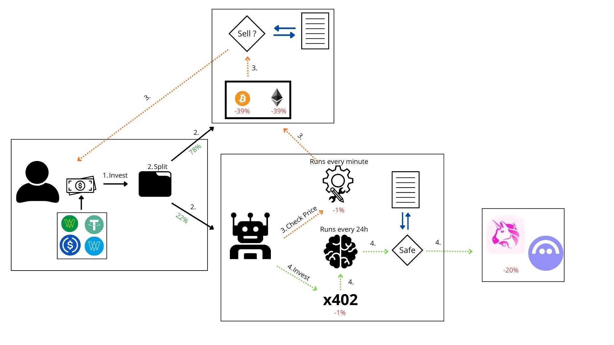

# Adgent Protocol
## Autonomous AI-Driven DeFi Investment System with Zero-Trust Security on Celo



### pinned: Quick Links & Resources
- **Live Web Application**: [https://fronted-ai-adgent.vercel.app/](https://fronted-ai-adgent.vercel.app/)
- **Video Demo**: [https://youtu.be/5EdqnuIB5ZA](https://youtu.be/5EdqnuIB5ZA)
- **Developer GitHub Profile**: [batublockdev (Batu)](https://github.com/batublockdev)

---

### scroll: Deployed Smart Contracts (Celo Mainnet)

| Contract Name | Deployed Address | GitHub Source File | Repository |
|:--- |:--- |:--- |:--- |
| **StockWallet** | [`0x573a678Ea7a51B51344fe6a1781BBCCbF0E453C7`](https://celoscan.io/address/0x573a678Ea7a51B51344f6a1781BBCCbF0E453C7) | [`StockWallet.sol`](https://github.com/batublockdev/stocktoken-wallet-uniswap/blob/main/src/StockWallet.sol) | [cstocktoken-wallet-uniswap`](https://github.com/batublockdev/stocktoken-wallet-uniswap) |
| **MinimalAccount** | [`0x74E16132B76Af0B3730F5c4BF540D777b085DDc`](https://celoscan.io/address/@x74E16132B76Af0B3730F5c4BF540D777b085DDc) | [`MinimalAccount.sol`](https://github.com/batublockdev/ai_adgent_rules_contract_solidity/blob/main/src/ethereum/MinimalAccount.sol) | [`ai_adgent_rules_contract_solidity`](hhttps://github.com/batublockdev/ai_adgent_rules_contract_solidity) |

---

### rocket: Ecosystem Repositories & Components

- **AI Agent Intelligence Engine**: [`bot_adgent`](https://github.com/batublockdev/bot_adgent)
  - Main Agent Logic: [`src/index.ts`](https://github.com/batublockdev/bot_adgent/blob/main/src/index.ts)
- **Monitoring & Risk Sentinel**: [`bot_Check_invest`](hhttps://github.com/batublockdev/bot_Check_invest)
  - Main Monitoring Bot: [`src/bot.js`](https://github.com/batublockdev/bot_Check_invest/blob/main/src/bot.js)
- **Smart Contract Rules & Account Abstraction Vault**: [`ai_adgent_rules_contract_solidity`](https://github.com/batublockdev/ai_adgent_rules_contract_solidity)
- **Portfolio Management & DEX Integration Wallet**: [`stocktoken-wallet-uniswap`](https://github.com/batublockdev/stocktoken-wallet-uniswap)

---

### lightbulb: Overview & System Architecture

**Adgent Protocol** is an autonomous, hybrid DeFi portfolio management ecosystem built on the Celo blockchain. It bridges LLM-driven market intelligence with strict, non-custodial, zero-trust smart contract execution.

#### Fund Distribution & Allocation Mechanics
When an investor or owner deposits USDC into `StockWallet.sol`:
1. **78% - Direct Asset Allocation**: Spent directly on token swaps to acquire the pre-configured basket of portfolio assets.
2. **20% - Smart Agent Vault (`MinimalAccount.sol`)**: Transferred directly to the AI Agent's smart contract account (`MinimalAccount.sol`) to fund autonomous trading and yield strategies.
3. **2% - Operational Gas Reserve**: Retained to cover transaction gas costs for automated execution.

```
[ Investor / Owner ]
         │ Deposit USDC
         ▼
 ┌─────────────────┐       Trigger invest()        ┌─────────────────┐
 │ StockWallet.sol │ ◄──────────────────────────── │   bot.js        │
 └────────┬────────┘   (Monitors balances/events)  └─────────────────┘
          │
          ├───► 78% Direct Asset Investment
          ├───►  2% Operational Gas Reserve
          │
          └───► 20% Agent Fee
                  │
                  ▼
       ┌────────────────────┐      Meta-TX signed      ┌────────────────────┐
       │ MinimalAccount.sol │ ◄─────────────────────── │     bot_adgent     │
       └──────────┬─────────┘  (Zero-Trust Rules)      │   (index.ts LLM)   │
                  │                                    └────────────────────┘
                  │ Executes Swaps/Deposits              Runs every 10 hours
                  ▼                                      via x402 Micropayments
       ┌────────────────────┐
       │ Uniswap V3 / Aave  │
       └────────────────────┘
```

---

### shield: Security Architecture & Zero-Trust Verification (`MinimalAccount.sol`)

-All investment operations generated by the AI Agent originate directly from `MinimalAccount.sol` via off-chain signed meta-transactions. To protect user funds against model hallucinations, unexpected outputs, or malicious call data, `MinimalAccount.sol` enforces three strict layers of on-chain validation:

1. **Target Contract Whitelist (`isAllowedTarget`)j**:
  - Meta-transactions can only interact with pre-approved target contracts (e.g., Uniswap V3 Universal Router, Permit2, Aave V3 Pool).

2. **Function Selector Whitelist (`isSelectorSupported`)**:
  - Restricts invocation strictly to verified function signatures required for swaps and liquidity provision.

3. **Recipient Invariant Enforcement (`RecipientInvalido`)**:
  - The contract dynamically inspects the raw `calldata` of the interaction to extract the intended recipient address.
  - If the recipient of the acquired tokens or assets is NOT `MinimalAccount.sol` (or an explicitly whitelisted recipient address), the transaction reverts instantly.

---

### robot: Autonomous Off-Chain Components

#### 1. AI Decision Engine (`bot_adgent/src/index.ts`)J- **Cycle Frequency**: Executes every 10 hours.
- **LLM Reasoning**: Gathers market feeds and portfolio balances, sending context to an LLM using **x402 micropayments in USDC*.
- **Confidence Gate**: Generates and signs trading transactions only when the LLM's confidence score reaches **≍9170%**.
- **Execution Source**: All signed trades execute out of `MinimalAccount.sola.

#### 2. Risk & Execution Sentinel (`bot_Check_invest/src/bot.js`)
- **Cycle Frequency**: Runs continuously every minute using `viem`.
- **Auto-Investment**: Automatically triggers `invest()` on `StockWallet.sol` upon detecting new USDC deposits.
- **Stop-Loss Protection**: Sells 100% of an asset and removes it from the portfolio when price falls below the stop-loss limit.
- **Take-Profit Harvest**: Liquidates only the profit fraction when an asset reaches its take-profit target.
- *(24-Hour Cooldown**: Imposes a 24-hour safety pause after any stop-loss or take-profit execution to eliminate churn and repeated bad swaps.

---

### wrench: Tech Stack & Protocols

- **Blockchain Platform**: Celo Mainnet
- **Smart Contract Language**: Solidity 0.8.x
- **DeFi Protocols**: Uniswap V3 (UNiversal Router, Permit2, QuoterV2), Aave V3
- **Automation & Off-Chain Runtime**: TypeScript, Node.js, Viem, PostgreSQL
- **AI & Micropayments**: x402 Protocol (USDC inference micropayments), LLM: Ollama Cloud / Gemini
- **Frontend Framework**: Next.js / React (Hosted on Vercel)
