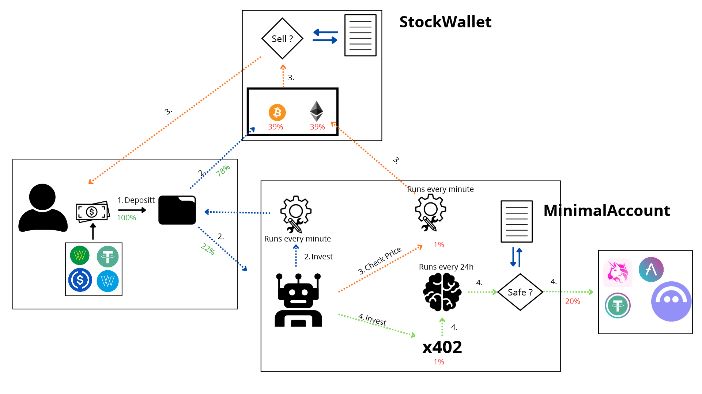

# Adgent Protocol
## Autonomous AI-Driven DeFi Investment System with Zero-Trust Security on Celo



### pinned: Quick Links & Resources
- **Live Web Application**: [https://fronted-ai-adgent.vercel.app/](https://fronted-ai-adgent.vercel.app/)
- **Video Demo**: [https://youtu.be/5EdqnuIB5ZA](https://youtu.be/5EdqnuIB5ZA)
- **Developer GitHub Profile**: [batublockdev (Batu)](https://github.com/batublockdev)

---

### scroll: Deployed Smart Contracts (Celo Mainnet)

| Contract Name | Deployed Address | GitHub Source File | Repository |
|:--- |:--- |:--- |:--- |
| **StockWallet** | [`0x573a678Ea7a51B51344fe6a1781BBCCbF0E453C7`](https://celoscan.io/address/0x573a678Ea7a51B51344f6a1781BBCCbF0E453C7) | [`StockWallet.sol`](https://github.com/batublockdev/stocktoken-wallet-uniswap/blob/main/src/StockWallet.sol) | [cstocktoken-wallet-uniswap`](https://github.com/batublockdev/stocktoken-wallet-uniswap) |
| **MinimalAccount** | [`0x74E16132B76Af0B3730F5c4BF540D777b085DDc`](https://celoscan.io/address/@x74E16132B76Af0B3730F5c4BF540D777b085DDc) | [`MinimalAccount.sol`](https://github.com/batublockdev/ai_adgent_rules_contract_solidity/blob/main/src/ethereum/MinimalAccount.sol) | [`ai_adgent_rules_contract_solidity`](hhttps://github.com/batublockdev/ai_adgent_rules_contract_solidity) |

---

### rocket: Ecosystem Repositories & Components

- **AI Agent Intelligence Engine**: [`bot_adgent`](https://github.com/batublockdev/bot_adgent)
  - Main Agent Logic: [`src/index.ts`](https://github.com/batublockdev/bot_adgent/blob/main/src/index.ts)
- **Monitoring & Risk Sentinel**: [`bot_Check_invest`](hhttps://github.com/batublockdev/bot_Check_invest)
  - Main Monitoring Bot: [`src/bot.js`](https://github.com/batublockdev/bot_Check_invest/blob/main/src/bot.js)
- **Smart Contract Rules & Account Abstraction Vault**: [`ai_adgent_rules_contract_solidity`](https://github.com/batublockdev/ai_adgent_rules_contract_solidity)
- **Portfolio Management & DEX Integration Wallet**: [`stocktoken-wallet-uniswap`](https://github.com/batublockdev/stocktoken-wallet-uniswap)

---

### lightbulb: Overview & System Architecture

**Adgent Protocol** is an autonomous, hybrid DeFi portfolio management ecosystem built on the Celo blockchain. It bridges LLM-driven market intelligence with strict, non-custodial, zero-trust smart contract execution.

#### Fund Distribution & Allocation Mechanics
When an investor or owner deposits USDC into `StockWallet.sol`:
1. **78% - Direct Asset Allocation**: Spent directly on token swaps to acquire the pre-configured basket of portfolio assets.
2. **20% - Smart Agent Vault (`MinimalAccount.sol`)**: Transferred directly to the AI Agent's smart contract account (`MinimalAccount.sol`) to fund autonomous trading and yield strategies.
3. **2% - Operational Gas Reserve**: Retained to cover transaction gas costs for automated execution.

```
[ Investor / Owner ]
         │ Deposit USDC
         ▼
 ┌─────────────────┐       Trigger invest()        ┌─────────────────┐
 │ StockWallet.sol │ ◄──────────────────────────── │   bot.js        │
 └────────┬────────┘   (Monitors balances/events)  └─────────────────┘
          │
          ├───► 78% Direct Asset Investment
          ├───►  2% Operational Gas Reserve
          │
          └───► 20% Agent Fee
                  │
                  ▼
       ┌────────────────────┐      Meta-TX signed      ┌────────────────────┐
       │ MinimalAccount.sol │ ◄─────────────────────── │     bot_adgent     │
       └──────────┬─────────┘  (Zero-Trust Rules)      │   (index.ts LLM)   │
                  │                                    └────────────────────┘
                  │ Executes Swaps/Deposits              Runs every 10 hours
                  ▼                                      via x402 Micropayments
       ┌────────────────────┐
       │ Uniswap V3 / Aave  │
       └────────────────────┘
```

---

### shield: Security Architecture & Zero-Trust Verification (`MinimalAccount.sol`)

-All investment operations generated by the AI Agent originate directly from `MinimalAccount.sol` via off-chain signed meta-transactions. To protect user funds against model hallucinations, unexpected outputs, or malicious call data, `MinimalAccount.sol` enforces three strict layers of on-chain validation:

1. **Target Contract Whitelist (`isAllowedTarget`)j**:
  - Meta-transactions can only interact with pre-approved target contracts (e.g., Uniswap V3 Universal Router, Permit2, Aave V3 Pool).

2. **Function Selector Whitelist (`isSelectorSupported`)**:
  - Restricts invocation strictly to verified function signatures required for swaps and liquidity provision.

3. **Recipient Invariant Enforcement (`RecipientInvalido`)**:
  - The contract dynamically inspects the raw `calldata` of the interaction to extract the intended recipient address.
  - If the recipient of the acquired tokens or assets is NOT `MinimalAccount.sol` (or an explicitly whitelisted recipient address), the transaction reverts instantly.

---

### robot: Autonomous Off-Chain Components

#### 1. AI Decision Engine (`bot_adgent/src/index.ts`)J- **Cycle Frequency**: Executes every 10 hours.
- **LLM Reasoning**: Gathers market feeds and portfolio balances, sending context to an LLM using **x402 micropayments in USDC*.
- **Confidence Gate**: Generates and signs trading transactions only when the LLM's confidence score reaches **≍9170%**.
- **Execution Source**: All signed trades execute out of `MinimalAccount.sola.

#### 2. Risk & Execution Sentinel (`bot_Check_invest/src/bot.js`)
- **Cycle Frequency**: Runs continuously every minute using `viem`.
- **Auto-Investment**: Automatically triggers `invest()` on `StockWallet.sol` upon detecting new USDC deposits.
- **Stop-Loss Protection**: Sells 100% of an asset and removes it from the portfolio when price falls below the stop-loss limit.
- **Take-Profit Harvest**: Liquidates only the profit fraction when an asset reaches its take-profit target.
- *(24-Hour Cooldown**: Imposes a 24-hour safety pause after any stop-loss or take-profit execution to eliminate churn and repeated bad swaps.

---

### wrench: Tech Stack & Protocols

- **Blockchain Platform**: Celo Mainnet
- **Smart Contract Language**: Solidity 0.8.x
- **DeFi Protocols**: Uniswap V3 (UNiversal Router, Permit2, QuoterV2), Aave V3
- **Automation & Off-Chain Runtime**: TypeScript, Node.js, Viem, PostgreSQL
- **AI & Micropayments**: x402 Protocol (USDC inference micropayments), LLM: Ollama Cloud / Gemini
- **Frontend Framework**: Next.js / React (Hosted on Vercel)

---

### trophy: Live Proof — Bot Survives ETH Crash & Protects Portfolio

> **The Adgent Protocol bot fulfilled its promise.** During the recent ETH crash triggered by the Binance hack, while many investors lost significant capital, our autonomous stop-loss system protected the portfolio — closing the WETH position automatically and limiting losses to only what was pre-configured as acceptable risk.

#### Timeline of Events

| Date (UTC) | Event | Details |
|:---|:---|:---|
| **Oct 22, 2026 — 20:49** | Contract Deployment | `StockWallet.sol` deployed on Celo Mainnet. Owner & agent roles assigned. |
| **Oct 22, 2026 — 23:34:42** | **First Investment Executed** | Bot auto-invested **0.863154 USDT** into the portfolio. |
| **Oct 24, 2026 — 18:43:42** | **Second Investment Executed** | Bot auto-invested **3.008949 USDT** into the portfolio. |
| **Oct 25, 2026 — 06:08:58** | **Third Investment Executed** | Bot auto-invested **0.060178 USDT** into the portfolio. |
| **Oct 30, 2026 — 00:19:05** | **STOP-LOSS TRIGGERED** | Bot detected ETH price crash and automatically sold the entire WETH position. |

#### Investment Breakdown

**First Investment — Oct 22, 2026 23:34:42 UTC**
- TX Hash: [`0xb8cf8f33e4ce5c94c7ec44a4d51dfd5e44093b8963682441bd77f9c0b426dc26`](https://celoscan.io/tx/0xb8cf8f33e4ce5c94c7ec44a4d51dfd5e44093b8963682441bd77f9c0b426dc26)
- Total invested: **0.863154 USDT**
- Allocation:
  - WETH swap: **0.336630 USDT** → 0.000141212560335808 WETH (ETH @ $2,383.85)
  - WBTC swap: **0.336630 USDT** → 0.00000413 WBTC
  - Agent Vault (`MinimalAccount.sol`): **0.172630 USDT**
  - Operational Gas Reserve: **0.017263 USDT**

**Second Investment — Oct 24, 2026 18:43:42 UTC**
- TX Hash: [`0x4a7efff26f01ae06e9b09c908d3a48007fa998402e4561d40564815071c61bc8`](https://celoscan.io/tx/0x4a7efff26f01ae06e9b09c908d3a48007fa998402e4561d40564815071c61bc8)
- Total invested: **3.008949 USDT**
- Allocation:
  - WETH swap: **1.173491 USDT** → 0.000503111851009673 WETH (ETH @ $2,332.47)
  - WBTC swap: **1.173491 USDT** → 0.00001460 WBTC
  - Agent Vault: **0.601789 USDT**
  - Operational Gas Reserve: **0.060178 USDT**

**Third Investment — Oct 25, 2026 06:08:58 UTC**
- TX Hash: [`0x732243abda48b9e82b02c77ce3a686a145d6416bcda28bd1bbb5654408a21ab5`](https://celoscan.io/tx/0x732243abda48b9e82b02c77ce3a686a145d6416bcda28bd1bbb5654408a21ab5)
- Total invested: **0.060178 USDT**
- Allocation:
  - WETH swap: **0.023470 USDT** → 0.000009979303778829 WETH (ETH @ $2,351.87)
  - WBTC swap: **0.023470 USDT** → 0.00000029 WBTC
  - Agent Vault: **0.012035 USDT**
  - Operational Gas Reserve: **0.001203 USDT**

#### Stop-Loss Execution — Oct 30, 2026 00:19:05 UTC

- TX Hash: [`0xee44fe34f7ce6030013c99d589a962486b5c60c133c953192b96fa7c7d0e508f`](https://celoscan.io/tx/0xee44fe34f7ce6030013c99d589a962486b5c60c133c953192b96fa7c7d0e508f)
- **Events emitted**: `AssetSold` + `StopLossExecuted`
- Asset sold: **0.000654303715124310 WETH** (entire WETH position)
- USDT recovered: **1.454219 USDT**
- WETH original cost basis: **1.533591 USDT**
- ETH price at sale: **$2,222.54**

#### Impact Analysis

| Metric | Value |
|:---|:---|
| Total USDT invested | 3.932281 USDT |
| Total invested in WETH | 1.533591 USDT (0.000654303715124310 ETH) |
| Total invested in WBTC | 1.533591 USDT (0.00001902 WBTC) |
| WETH position sold for | 1.454219 USDT |
| **Realized loss on WETH** | **-0.079372 USDT (-5.18%)** |
| ETH price at last purchase | $2,351.87 |
| ETH price at stop-loss sale | $2,222.54 |
| **USDT protected by stop-loss** | **1.454219 USDT recovered to stablecoin** |

#### What Would Have Happened Without the Stop-Loss?

If the bot had NOT executed the stop-loss and the portfolio continued holding WETH as ETH kept falling:

- The WETH position would remain exposed to continued downside with no automatic exit.
- The stop-loss **automatically converted the crashing asset back to USDT (a stablecoin)**, locking in the recovered value and protecting it from further market collapse.
- The 24-hour cooldown then prevented the bot from immediately re-entering the market during high volatility.

> **Key takeaway**: The bot did exactly what it was designed to do. It invested, monitored continuously (every minute), detected the crash, and executed the stop-loss autonomously — no human intervention required. The investor only lost **0.079372 USDT (-5.18%)** on the WETH position, while **1.454219 USDT was preserved** in stablecoin.

#### All Verified On-Chain Transactions

| # | TX Hash | Date (UTC) | Action | Status |
|:---|:---|:---|:---|:---|
| 1 | [`0x74de664f...`](https://celoscan.io/tx/0x74de664f7e690cfb184e44ebc43d95ab2c08d39574e9b5b3e51ae82e7c2f1b24) | Oct 22, 20:49 | Contract deployment | ✅ SUCCESS |
| 2 | [`0xb8cf8f33...`](https://celoscan.io/tx/0xb8cf8f33e4ce5c94c7ec44a4d51dfd5e44093b8963682441bd77f9c0b426dc26) | Oct 22, 23:34 | `invest()` — **first investment** | ✅ SUCCESS |
| 3 | [`0x4a7efff2...`](https://celoscan.io/tx/0x4a7efff26f01ae06e9b09c908d3a48007fa998402e4561d40564815071c61bc8) | Oct 24, 18:43 | `invest()` — **second investment** | ✅ SUCCESS |
| 4 | [`0x732243ab...`](https://celoscan.io/tx/0x732243abda48b9e82b02c77ce3a686a145d6416bcda28bd1bbb5654408a21ab5) | Oct 25, 06:08 | `invest()` — **third investment** | ✅ SUCCESS |
| 5 | [`0xee44fe34...`](https://celoscan.io/tx/0xee44fe34f7ce6030013c99d589a962486b5c60c133c953192b96fa7c7d0e508f) | Oct 30, 00:19 | **STOP-LOSS — WETH sold** | ✅ SUCCESS |

> All transactions are publicly verifiable on [CeloScan](https://celoscan.io/address/0x573a678Ea7a51B51344fe6a1781BBCCbF0E453C7). The `StopLossExecuted` event (topic `0x643ee423...`) was emitted on-chain as immutable proof of the autonomous protection.
